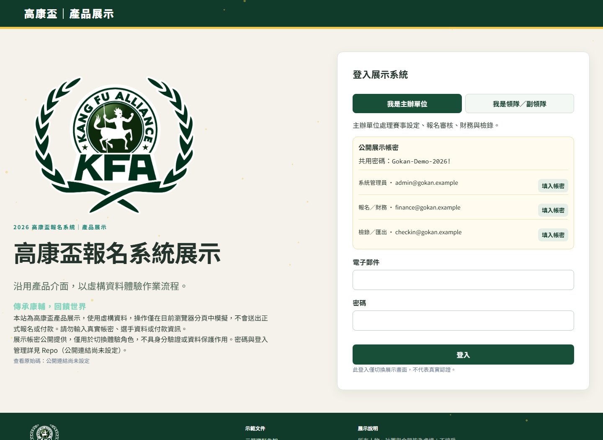
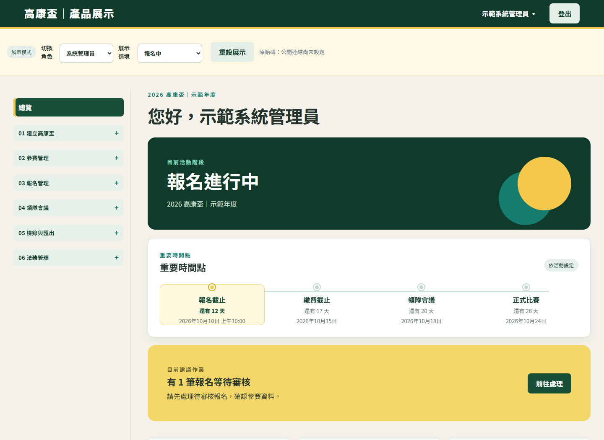

# Gokan｜高康盃報名與賽務管理系統

Gokan 把一屆高康盃從年度設定、社團名單、聯隊與賽事配置，到報名審核、費用核對、領隊會議及檢錄匯出的作業，放進同一套有角色、狀態與資料一致性規則的產品。

**線上展示預定網址：** `https://gokan-showcase.vercel.app`  
**原始碼倉庫預定網址：** `https://github.com/tingweihu/gokan-open`
**原始碼倉庫：** 公開網址尚未確認

展示網址是預定地址，目前無法解析；原始碼倉庫公開網址尚未確認。現在可依[本機查看 Showcase](#本機查看-showcase)操作純前端展示站。展示中的人物、社團、金額與操作結果均為虛構資料。

## 閱讀導覽

- [主辦單位、活動與本專案](#主辦單位活動與本專案) · [產品問題](#為什麼需要這套系統) · [展示畫面](#展示畫面) · [工作流程](#產品邊界與工作流程)
- [角色與操作權限](#角色與資料範圍) · [架構與資料流](#架構與資料流) · [資料模型](#domain-與資料庫) · [API 範例](#api-的設計方式)
- [賽務規則](#幾個關鍵的賽務規則) · [產品登入](#產品帳號與登入) · [資安](#資訊安全與個資界線) · [本機啟動](#本機查看-showcase) · [年度接手與 AI 學習](#為什麼公開以及如何接手) · [聯絡及授權](#聯絡方式)

## 主辦單位、活動與本專案

**主辦單位。**社團法人中華康樂輔導聯盟，簡稱康輔聯盟或康聯，以「傳承康輔，回饋世界」為宗旨，提供社團課程、活動規劃與帶領、社團指導及幹部訓練等服務；詳見[康聯官網](https://www.kfking.org/)。

**活動。**高康盃是[康聯介紹](https://www.kfking.org/image)的「全國高中職康樂輔導人員運動大會」。各年度時間與賽務規則以當年度主辦公告及系統設定為準；展示數據不代表實際參加人數。

**本專案。**Gokan 支援高康盃的年度設定、領隊報名、主辦審核與檢錄，也讓康聯及後續主辦人員透過公開程式與純前端 Showcase 學習使用 AI 理解、維護和延續這套產品。康聯官網的活動介紹不構成本軟體的功能或授權保證。公開聯絡入口見[康聯官網](https://www.kfking.org/contact)。

## 為什麼需要這套系統

高康盃的報名不只是在截止日前收齊表單。主辦單位須先確定年度的賽事、名額、時段、收費與作業期限；社團要建立選手並依規則決定能否組成聯隊；一位選手可能參加多項賽事，卻不能在同一時間出現在兩個場次，也不能被不同報名單位重複占用同一賽事名額。報名送出後還有退回補正、正式確認、付款審核、領隊會議加報與錄取、賽前異動及最終檢錄。

這些環節彼此牽動。例如，變更隊伍會影響賽事資格與費用；發布時程前要檢查選手及場地衝突；會議結束前須處理待錄取隊伍、最終名單與財務狀態。Gokan 以年度活動和報名單位作為範圍，讓介面提供操作入口，並由伺服器在每次重要變更時重新檢查規則。

## 展示畫面

以下為純前端展示站，畫面資料皆為虛構。



*首頁與角色入口。*



*系統管理員主工作區，顯示年度階段、重要時間點與待辦。*

## 產品邊界與工作流程

一套 Gokan 部署服務一個主辦單位，以 `Activity` 保存各年度資料。年度之間的社團、選手、報名、賽事與帳號指派透過活動關聯分開；系統沒有供任意客戶自行建立租戶的流程。這是為年度賽務而選的產品邊界，不是通用多租戶服務。

| 階段 | 主辦單位與社團在系統中的工作 |
| --- | --- |
| 年度與帳號 | 管理員建立年度、日期與社團，指派當年度工作人員及社團領隊／副領隊。 |
| 名單與聯隊 | 社團建立來源選手；符合年度聯隊規則的社團可發起或確認聯隊，聯隊資格隨成員與名單重新評估。 |
| 賽事與時程 | 管理員設定賽事的報名單位、人數及組成限制，編輯時程草稿，檢查衝突後發布。 |
| 隊伍與報名 | 社團或聯隊在允許階段選擇賽事、建立 A／B 隊及配置選手；送出時由伺服器驗證。 |
| 審核與費用 | 承辦人退回或確認報名，核對付款與退款；年度費率由系統管理員設定。社團報名送審前需附總參賽名單 PDF。 |
| 領隊會議與賽前異動 | 管理員控制會議階段；可開放加報與待錄取隊伍處理，再收束為既有項目的人員調整，最後檢查名單及財務並關閉會議。 |
| 檢錄與匯出 | 具權限的工作人員取得檢錄資料與 CSV／XLSX；管理員可取得年度資料及封存用途的匯出。 |

作業能否執行還取決於活動日期、報名狀態及會議狀態。畫面上的按鈕只是提示；真正的權限與階段檢查在 API 服務中。

## 角色與資料範圍

| 角色 | 實際用途與邊界 |
| --- | --- |
| `SYSTEM_ADMIN` | 管理年度與社團、帳號指派、賽事與時程、年度費率、會議轉階段及年度匯出。重要設定與控制動作由此角色執行。 |
| `REGISTRATION_FINANCE` | 處理報名審核與付款／退款核對；其可見資料仍須限定在指派的年度活動，不具有年度費率設定權限。 |
| `CHECKIN_EXPORT` | 取得指派年度的檢錄名單與檢錄匯出，不等同年度設定或財務管理權限。 |
| `LEADER` | 在所屬社團及已確認聯隊的範圍內管理名單、隊伍與報名。 |
| `DEPUTY` | 憑所屬社團的有效成員指派，參與該社團的選手名單、報名與隊伍作業；聯隊的負責社團、成員確認及作業階段仍各有額外限制。 |

伺服器查詢 `ActivityStaff`、`OrganizationMembership`、報名所屬社團及聯隊已確認成員，才允許讀取或修改資料。即使知道另一筆資料的 ID，也不應因此取得跨年度或跨社團的操作權限。

下表以**實際服務端檢查**概括主要操作；「主辦」均指該年度有效 `ActivityStaff`，「社團」指有效 `OrganizationMembership`，不是登入後自動取得全部資料。`LEADER` 與 `DEPUTY` 在多數社團操作均經相同成員資格檢查；報名歸屬、聯隊責任與作業階段仍會限制具體操作。

| 操作 | 可執行者與資料範圍 | 階段及附加條件 |
| --- | --- | --- |
| 年度、社團、賽事、時程編輯及發布 | `SYSTEM_ADMIN`，指派年度；社團名單的讀取另依可見範圍 | 年度日期、賽事及草稿有開放期／既有資料鎖定；發布檢查衝突。 |
| 帳號建立、重設、停用、指派 | `SYSTEM_ADMIN`，指派年度的帳號 | 建立須指定年度職務或社團；不得撤銷最後一位有效管理員。 |
| 年度費率、項目費、匯款文字 | `SYSTEM_ADMIN`，指派年度 | 修改驗證版本與金額；已存在費用資料時按服務規則檢查。 |
| 來源選手名單查看／編輯 | 年度 `SYSTEM_ADMIN`／`REGISTRATION_FINANCE` 可依服務查看；有效社團成員可編輯自己社團 | 編輯受報名與會議階段及選手占用限制；查看權不推出編輯權。 |
| 聯隊發起／邀請／確認 | 有效社團成員發起自己社團的聯隊；負責社團或年度管理員管理邀請；受邀社團成員確認自己社團 | 同年度、資格、成員確認與既有報名限制；已確認成員不等於聯隊所有管理權。 |
| 參賽項目、隊伍及人員配置 | 自己社團報名的有效成員；聯隊部分修改限**已確認的負責社團**成員 | 項目須已發布且符合報名單位；`DRAFT`／`RETURNED` 或指定會議窗口，並受名額、來源與版本限制。 |
| 報名送出／退回／確認 | 所屬社團或聯隊負責社團送出；`SYSTEM_ADMIN`／`REGISTRATION_FINANCE` 審核指派年度 | 送出須在允許階段且驗證通過；退回／確認只接受 `SUBMITTED`，確認前再驗證。 |
| 付款提交、付款／退款審核 | 所屬報名範圍提交；`SYSTEM_ADMIN`／`REGISTRATION_FINANCE` 審核指派年度 | 狀態、金額、已確認付款及待處理退款均再檢查；審核有版本檢查。 |
| 領隊會議開始、收束、關閉及待錄取隊伍處理 | `SYSTEM_ADMIN`，指派年度 | 依會議狀態轉換；關閉前驗證待錄取隊伍、最終資料與財務。 |
| 檢錄、年度與封存匯出 | `CHECKIN_EXPORT` 取得指派年度檢錄資料；年度管理員可作年度／封存匯出 | 匯出種類各有服務端角色檢查，檢錄資料仍以目前正式資料為準。 |

角色指派可撤銷，社團也可停用；`User` 仍可存在但不再具有該年度或社團權限。登入、持有有效 Cookie、看得到側欄入口，都不足以讓一次變更通過。服務還會檢查物件所屬年度、聯隊的**已確認**成員與負責社團、報名狀態及目前階段。主要入口見 [IdentityService](apps/api/src/identity.service.ts)、[CompetitionService](apps/api/src/competition.service.ts)、[RegistrationService](apps/api/src/registration.service.ts) 與 [LeagueService](apps/api/src/league.service.ts)。

## 架構與資料流

```text
瀏覽器 → apps/web（Next.js 產品介面與同源 /api 轉送）
       → apps/api（NestJS 路由、身分／範圍／業務規則）
       → Prisma → PostgreSQL

瀏覽器 → apps/showcase（Next.js 靜態輸出、瀏覽器內虛構狀態）
```

`apps/web` 顯示產品畫面，透過同源 `/api` 路由轉送到產品 API；`apps/api` 接收請求、驗證資料並執行年度賽務規則。Prisma 定義模型及資料存取，PostgreSQL 以唯一鍵、檢查約束與觸發器守住重要關聯。`apps/showcase` 使用相似介面，但由本機 `demoApi` 回應，沒有產品 API、Prisma 或資料庫連線。

| 選擇與入口 | 目前用途及本案價值 | 需要承擔的限制 |
| --- | --- | --- |
| [產品 Web](apps/web/app) 與[同源轉送](apps/web/app/api/%5B...path%5D/route.ts) | Next.js 處理畫面、表單狀態與 Cookie 請求；瀏覽器只打同源 `/api`，轉送器才用 `API_INTERNAL_URL` 到 Nest API。 | 同源代理不是授權層；產品 Web 和 API 仍須正確設定來源與部署網路。 |
| [API](apps/api/src/main.ts) 的 controller／service | NestJS 路由進入身分、年度與物件範圍、階段及業務驗證，適合把多角色規則集中於伺服器。 | 服務檢查須涵蓋每條路徑；前端按鈕只能協助操作，不能取代檢查。 |
| [Prisma 模型](packages/database/prisma/schema.prisma) 與 PostgreSQL | Prisma 查詢和交易操作實體模型；SQL migration 補唯一鍵、CHECK 及跨表觸發器，作資料庫最後保護。 | 需 PostgreSQL 與 Prisma 引擎；初始化 SQL 僅供新空資料庫，既有資料庫需另規劃遷移。 |
| [獨立 Showcase](apps/showcase) | 靜態輸出、`demoApi` 與分頁內虛構狀態，便於展示已驗收的畫面與流程。 | 角色密碼不是產品認證，重新整理／重設會依展示儲存方式變化，不能用來承辦真實賽務。 |
| [共用套件](packages) | `database` 放 schema 與 migration；`config` 匯出 API／Web 環境驗證函式，目前 API main 使用 API 驗證；`auth` 目前只匯出 Cookie 名與密碼長度常數，`ui` 目前是小型 `Button`，`validation` 提供少量 Zod schema。 | 實際身分服務與多數驗證仍在 `apps/api`；套件存在不表示所有介面或安全邏輯已抽成共用層。 |

以「社團送出報名」為例：[產品畫面](apps/web/app/portal.tsx) 透過同源 `/api/registrations/:registrationId/submit` 傳 `rowVersion` 與 `reason`；[代理](apps/web/app/api/%5B...path%5D/route.ts) 轉為 Nest 的 `/registrations/:registrationId/submit`；[controller](apps/api/src/registration.controller.ts) 交給 [RegistrationService.submit](apps/api/src/registration.service.ts)。服務驗證登入與所屬報名範圍、年度及階段，在交易中重新驗證名單、總參賽名單及版本，才更新 `Registration`；[schema](packages/database/prisma/schema.prisma) 和[SQL 約束](packages/database/prisma/migrations/001_initial/migration.sql)守住關聯底線。回應是更新的報名及驗證結果，前端再更新畫面；若不符規則，API 回傳可讀 `code`。

### Domain 與資料庫

`Activity` 是年度邊界。`Organization` 保留社團，`Participant.sourceOrganizationId` 保留選手來源；`League` 與 `LeagueMember` 描述聯隊及成員確認。`CompetitionEvent`、`ScheduleVersion`、`EventTimeWindow` 描述賽事及發布時段；`Registration`、`EventEntry`、`Team`、`TeamMember` 描述一個報名單位如何參加賽事。`ParticipantEventClaim` 另記錄選手在某年度、某賽事由哪一份報名占用。`FeeSchedule`、`Payment`、`Refund` 與 `LeaderMeeting` 及其快照保存後續作業。

| 業務領域 | 關鍵欄位與存在理由 |
| --- | --- |
| 年度與身分 | `Activity.year`、`code` 及各開放／截止時間界定年度；`User` 是登入身分，`ActivityStaff.activityId` 與 `OrganizationMembership.organizationId` 才是特定年度職務及社團成員關係，`revokedAt` 代表撤銷。 |
| 名單與聯隊 | `Participant.sourceOrganizationId` 固定選手來源；`League.ownerOrganizationId` 決定發起／負責社團，`LeagueMember.status`／`confirmedAt` 區分邀請與已確認加入，`LeagueRule` 保存當年度資格門檻。 |
| 報名與時程 | `Registration.organizationId`／`leagueId` 擇一表示報名單位；`status` 與 `rowVersion` 管送審及防覆寫。`EventEntry.registrationId`／`eventId` 連報名和賽事，`Team.ordinal` 與 `admissionStatus` 區分 A／B 隊及錄取；`TeamMember.participantId` 是實際配置，`ParticipantEventClaim` 的年度／賽事／選手唯一鍵防重複占用。`ScheduleVersion.status` 與 `EventTimeWindow.startAt`／`endAt` 決定已發布賽程的時間判斷。 |
| 費用與檔案 | `FeeSchedule` 保存三類費率，`EventFeeOverride.teamEntryFee` 覆蓋單一項目；應繳與實收是服務**衍生計算**，非報名表欄位。`Payment.status`、`Refund.status` 決定哪些金額計入；`Attachment.storageKey`、`mimeType`、`sha256` 是檔案中繼資料，檔案位元組由服務另存。 |
| 會議與登入 | `LeaderMeeting.status`／`rowVersion` 控制階段，`LeaderMeetingSnapshot.kind`／`payload` 保存必要的基準及最終業務快照，並非通用稽核。`Session.tokenHash` 存工作階段 token 的雜湊、`expiresAt`／`revokedAt` 管有效性；`LoginAttempt.accountKey`／`sourceKey` 用於限流。 |

逐模型的欄位型別、可空、預設值、資料表對應、鍵與敏感度見 [DATABASE.md](DATABASE.md)。`rowVersion` 只存在於 schema 明定的模型，不是全部資料表共有欄位。

應用服務負責有時間與身分脈絡的規則，例如聯隊資格、賽事組成、時段衝突、送審資格、會議階段與財務計算。資料庫再以約束守住不應因並行請求或漏檢而破壞的底線：一份報名只能屬於社團或聯隊其中一方、同一賽事的選手占用不可重複、隊伍與選手必須連到相符活動及賽事、付款與附件不能跨年度關聯。完整模型和**僅供新空資料庫初始化**的 SQL 說明見 [DATABASE.md](DATABASE.md)。

### API 的設計方式

API 以年度、報名、賽事和隊伍等資源為路徑範圍，例如 `activities/:activityId`、`registrations/:registrationId`。請求即使帶有合法 UUID，服務仍會檢查操作者是否屬於該年度、社團或聯隊。輸入使用 Zod 驗證；變更資料時由伺服器判斷階段、資格與關聯，不接受前端宣稱的權限或計算結果。

需要防止覆寫的變更帶 `rowVersion`；若資料在讀取後已被其他人更新，服務回覆版本衝突，要求重新整理。多步驟作業使用資料庫交易，必要時以交易範圍的 advisory lock 序列化同一年度、報名或選手的操作。API 對驗證失敗、權限不足、狀態不合及並行衝突回傳機器可讀的 `code`、訊息與有限細節；未預期錯誤不把內部堆疊傳給瀏覽器。

下列路徑是 [Nest controller](apps/api/src) 的**實際後端路徑**，沒有全域 `/api` prefix。產品瀏覽器在它們前面加 `/api`，由 [Next 代理](apps/web/app/api/%5B...path%5D/route.ts)轉送並保留 Cookie、Origin 與必要回應標頭。範例是代表性路由，並非完整 API 清單；`id` 是 UUID，所有受保護路由先驗證產品工作階段。

| 方法與後端路徑 | 用途；角色與資料範圍 | 主要輸入；階段與常見錯誤 |
| --- | --- | --- |
| `POST /auth/login` | 帳密登入，依所選主辦／領隊入口檢查指派 | `email`、`password`、可選 `entryMode`；401 `AUTH_INVALID_CREDENTIALS`、429 `AUTH_THROTTLED`。 |
| `POST /activities/:activityId/accounts/bulk-commit` | 年度管理員批次建立社團與領隊帳號 | 預覽後的 `rows`、`fingerprint`；409 `STALE_VERSION`／`DUPLICATE_RECORD`。 |
| `PATCH /activities/:activityId` | 年度管理員更新指派年度設定 | 完整年度設定、`rowVersion`、`reason`；開放後日期鎖定，409 `ACTIVITY_STAGE_FORBIDS_ACTION`／版本衝突。 |
| `POST /activities/:activityId/leagues` | 有效社團成員以自己社團發起聯隊 | `name`、`ownerOrganizationId`、`reason`；同年度資格與重複申請限制。 |
| `POST /leagues/:leagueId/members/:memberId/confirm` | 受邀社團成員或年度管理員確認該成員 | `rowVersion`、`reason`；解散／重複聯隊限制，403 `FORBIDDEN` 或 409。 |
| `POST /event-entries/:entryId/teams` | 所屬報名範圍建立隊伍；聯隊修改限已確認負責社團 | `ordinal`、`rowVersion`；名額、A／B 順序與階段限制，409 `TEAM_SIZE_INVALID`／`STALE_VERSION`。 |
| `POST /registrations/:registrationId/submit` | 社團或聯隊負責社團送出自己的報名 | `rowVersion`、`reason`；限可送出階段及 `DRAFT`／`RETURNED`，422 `SUBMISSION_BLOCKED`／`TOTAL_ROSTER_REQUIRED`。 |
| `POST /registrations/:registrationId/confirm` | 年度管理員或報名／財務人員確認待審報名 | `rowVersion`、`reason`；限 `SUBMITTED` 且再驗證，409 `REGISTRATION_TRANSITION_INVALID`、422 `CONFIRMATION_BLOCKED`。 |
| `POST /payments/:paymentId/confirm` | 年度管理員或報名／財務人員確認指派年度付款 | `rowVersion`、可選 `reason`／`receivedAmount`；限 `SUBMITTED`，409 `PAYMENT_MISMATCH`／`STALE_VERSION`。 |
| `POST /activities/:activityId/leader-meeting/close` | 年度管理員關閉領隊會議 | `reason`；須先收束項目異動並通過最終名單及財務檢查，409 `TEAM_ADMISSION_PENDING` 等。 |
| `GET /activities/:activityId/check-in.csv` | 年度管理員或檢錄／匯出人員取得指派年度檢錄資料 | 可選 `eventId`；須有 `CLOSED` 會議與最終快照，409 `FINAL_PACK_NOT_READY`。 |

**範例 1：送出報名與版本衝突。**以合成 ID `11111111-1111-4111-8111-111111111111` 表示自己有權操作的報名。瀏覽器 `POST /api/registrations/11111111-1111-4111-8111-111111111111/submit`，JSON 為 `{"rowVersion":1,"reason":"名單與隊伍已核對"}`。對應後端 `/registrations/.../submit` 的 [Zod schema](apps/api/src/registration.service.ts) 要求這兩欄且不接受多餘欄位。成功時 Nest 的 POST 回 201，內容為更新後 `Registration` 欄位（例如 `status: "SUBMITTED"`、遞增的 `rowVersion`、`submittedAt`）及 `validation`；時間、ID 與驗證內容以實際資料為準。舊版本會回 409 `{"code":"STALE_VERSION","message":"報名資料已更新，請重新整理","details":{}}`；送出條件未滿足則可能為 422 `SUBMISSION_BLOCKED`，社團報名未附總名單則為 422 `TOTAL_ROSTER_REQUIRED`。服務在交易中重新檢查範圍與階段，資料庫更新也比對 `rowVersion`。

**範例 2：付款審核。**主辦審核人對合成付款 ID `22222222-2222-4222-8222-222222222222` 發 `POST /api/payments/22222222-2222-4222-8222-222222222222/confirm`，JSON 可為 `{"rowVersion":1,"reason":"與入帳資料核對"}`；`receivedAmount` 是可選非負整數，若提供會寫入 `reviewNote` 文字，**不會覆寫 `Payment.amount`**。成功時 POST 回 201 與更新後的 `Payment`（`status: "CONFIRMED"`、審核人／時間、備註及新版本）。非 `SUBMITTED` 回 409 `PAYMENT_MISMATCH`，舊版本回 409 `STALE_VERSION`，無年度審核職務回 403 `FORBIDDEN`。[FinanceService.reviewPayment](apps/api/src/finance.service.ts) 在交易和付款鎖內再讀狀態。這些是 API 合約示例，不是真實帳款。

Zod 的 [parse](apps/api/src/core.ts) 處理輸入形狀與型別，服務再判斷資格、時間、金額及跨表規則；不是每項修改都使用同一把鎖。[ApiErrors](apps/api/src/core.ts) 將常見 Prisma 衝突映射為有限的 `code`／`message`／`details`，未預期錯誤只回通用訊息。前端應保留可修正的欄位提示，遇 `STALE_VERSION` 重新載入資料後再讓人確認；DB 和 API 服務才是權威，前端計算或隱藏按鈕不是授權證明。

## 幾個關鍵的賽務規則

### 時間衝突與發布

時段採「起點包含、終點不包含」的區間語意：09:00–10:00 與 10:00–11:00 不重疊；09:00–10:01 與 10:00–11:00 重疊。發布時程時，伺服器檢查同一選手所參與的不同賽事是否重疊，也檢查同場地的不同賽事是否重疊。有衝突時保留草稿並回傳阻擋內容；選手加入新隊伍時也會對已發布時程檢查衝突。

### 聯隊與選手來源

社團是否可參加聯隊，依當年度規則及有效選手名單評估，包含人數與性別比例等條件；聯隊本身還須滿足成員數、成員確認、各社團資格及有效參賽選手數等檢查。資格結果可隨名單與成員變更而改變。聯隊報名可用的選手來自**已確認加入的成員社團**，選手的來源社團不會因編入聯隊而改寫。

### 隊伍與選手占用

一筆 `EventEntry` 是某報名單位對某賽事的參加紀錄；其下可有依序號區分的隊伍。隊伍配置要符合賽事人數、性別、年級及報名單位來源規則。只用 `participant ↔ event` 的多對多關係無法表達「由哪個報名單位、哪個賽事項目及哪支隊伍使用」，也無法處理 A／B 隊、退出後重配或跨報名重複使用。`TeamMember` 記錄實際配置，`ParticipantEventClaim` 的唯一鍵則防止同一年度、同一賽事的選手被兩份報名同時占用；服務在加入、移除及替換時同步維護兩者。

### 報名與財務

報名從 `DRAFT` 編輯，送出後為 `SUBMITTED`；承辦人可退回成 `RETURNED` 供補正，或在再次驗證後確認為 `CONFIRMED`。送出與確認並非單純改狀態：服務會重新檢查聯隊／社團有效性、賽事是否可報、隊伍組成、選手來源、名額占用及時間衝突。已送審資料須先退回才可按一般流程修改；已確認資料的異動另受會議階段限制。

費用由年度的報名基本費、**正式錄取隊伍中的不重複選手數**乘以選手費，以及各個「至少有一隊正式錄取」的賽事項目費組成；**個別賽事的項目費設定優先於年度預設值**，明確設定為零元時仍以零元計。付款先由使用者提交，再由承辦人確認或拒絕；只有已確認付款計入實收。已完成退款自實收扣除，待處理退款會限制可再申請的額度。財務資格以已設定費率及「確認付款減已完成退款」是否達應繳額判斷，不等同上傳付款證明或提交付款資訊就已結清。

### 領隊會議與會後異動

會議狀態依序為 `SCHEDULED`、`ENTRY_OPEN`、`ENTRY_CLOSED_PARTICIPANT_OPEN`、`CLOSED`。開始時記錄基準快照；開放賽事項目異動期間可依規則處理加報與待錄取隊伍。關閉項目異動後，不再新增賽事項目，既有隊伍的人員調整仍受階段、來源與賽事規則限制。正式關閉前，系統檢查待錄取隊伍、已確認報名的最終資料及財務資格，並保存最終快照；`CLOSED` 後已確認報名不再按領隊端一般操作修改。這是依作業階段收束的流程，不是任意狀態都可新增、修改與刪除的資料表。

### 名單建議

伺服器保留規則式、**可重現**的名單建議與整份報名的配置預覽／套用。它們不是 AI 推薦：程式依固定排序與賽事規則選擇候選人，保留既有手動配置，檢查來源、性別／年級與隊伍人數、跨報名的賽事占用，以及已發布時段的衝突。未被分配到某場次的合格選手可以休息或參加其他場次，不會單因閒置而被判為錯誤。整份報名的搜尋有節點預算，無法滿足硬限制時回傳阻擋理由；預覽結果仍須在套用時重新檢查資料版本。

## 產品帳號與登入

產品的登入是 `User.email`／`normalizedEmail` 加密碼，與 Showcase 公開帳密分離。[bootstrap 指令](apps/api/src/bootstrap-cli.ts)在**全新、沒有使用者及年度資料的資料庫**建立第一位 `SYSTEM_ADMIN`、第一個年度 `Activity` 與初始告知／條款；它需要私下提供管理員 Email、姓名、臨時密碼與年度，不是可在既有資料庫反覆執行的重設工具。登入身分 `User` 本身不等於職務：管理員透過 [帳號路由](apps/api/src/accounts.controller.ts)將使用者連到特定年度的 `ActivityStaff`，或特定社團的 `OrganizationMembership`，並可撤銷指派。

| 生命週期 | 目前實作及交付界線 |
| --- | --- |
| 單筆建立工作人員 | 管理員在表單提供 Email、姓名、角色和 12–256 字元臨時密碼；API 雜湊後儲存，只回不含密碼的帳號欄位。密碼由管理員私下交付，程式沒有自動寄送。 |
| 建立社團與批次匯入 | 社團單筆 UI 與 XLSX 匯入皆先預覽，再由 `bulk-commit` 為領隊／副領隊產生隨機臨時密碼；[AccountsController](apps/api/src/accounts.controller.ts)把帳號和社團成員指派一併寫入，回傳一次性的 XLSX 帳密檔，產品畫面立即下載並在本次畫面可再下載。後端保存雜湊，不提供日後讀回明文的 API；檔案的安全保管與人工發放由管理者負責。 |
| 首次登入與告知 | 密碼登入建立工作階段後，`firstLoginRequired` 會阻擋一般操作，先以舊密碼改成新密碼。已發布且必須的 `PolicyDocument` 對非工作人員要求 `UserConsent`；有效領隊／副領隊每次工作階段還須確認目前告知版本。是否顯示哪一步由實際帳號與政策狀態決定。 |
| 日後變更及失去存取權 | 使用者改密碼須提供目前密碼，服務撤銷既有工作階段並發新工作階段；管理員重設為其提供的新臨時密碼時，設回首次登入並撤銷全部工作階段；停用帳號亦撤銷工作階段。撤銷年度職務或社團指派會使後續服務端權限檢查失敗，但不是把該使用者的所有其他年度指派一併刪除。登出撤銷目前工作階段。 |
| 忘記密碼 | 登入頁請使用者聯絡主辦單位；目前沒有自助重設、寄信或自動通知整合。管理員可用帳號管理重設。不要把一次性帳密下載誤認成郵件發送。 |

上列流程可從 [IdentityService](apps/api/src/identity.service.ts)、[AccountsController](apps/api/src/accounts.controller.ts)與[產品畫面](apps/web/app/portal.tsx)核對。真正帳密及一次性下載檔不屬於本公開倉庫或 Showcase 資料。

### 目前登入方式與外部登入的取捨

目前模式由主辦建立帳號、安排臨時密碼、指派年度／社團權限及處理重設。它讓角色與賽務資料歸屬可由本產品直接管理，代價是管理者須負責帳號發放、恢復與交接。**身分驗證**只確認誰登入；**賽務授權**還要查該人當年度的職務或社團指派、資料歸屬與操作階段。現有產品沒有 Google 登入、單一登入（SSO）或自動帳號佈建；兩種登入模式的安全性仍取決於具體實作與營運設定。

未來若評估外部身分登入，須依 [Google 的 ID token 驗證說明](https://developers.google.com/identity/gsi/web/guides/verify-google-id-token)或 [OpenID Connect 說明](https://developers.google.com/identity/openid-connect/openid-connect)驗證提供者身分，設計穩定識別與現有 `User` 的關聯；再分別評估年度角色指派、停用／撤銷、交接與帳號恢復。Google 身分登入不會自動授與 `ActivityStaff` 或 `OrganizationMembership` 權限。這是可評估的整合方向，並非現有產品功能。

## 資訊安全與個資界線

以下說明程式目前實作的保護，不代表部署後自動符合任何法規或可免除主辦單位的資安與個資管理責任。

| 項目 | 程式中的做法 |
| --- | --- |
| 密碼與登入 | 產品密碼以 Argon2id 雜湊；登入嘗試依帳號、來源及總量做短期限流。首次登入可要求改密碼。 |
| 工作階段 | 產品產生隨機不透明 token，資料庫保存其 SHA-256 雜湊及到期、撤銷資訊；瀏覽器 cookie 設 `HttpOnly`、`SameSite=Lax`，正式環境加 `Secure`。登出與改密碼會撤銷工作階段。 |
| 授權範圍 | API 每次依有效年度職務、社團成員身分及報名歸屬檢查；不因前端隱藏按鈕或知道資源 ID 就放行。 |
| 跨站請求 | 變更請求須帶與設定相符的 `Origin`；產品前端以同源路由轉送 API。這裡採 Origin 檢查，沒有宣稱另有 CSRF token。 |
| 上傳與匯出 | 付款證明限 PDF／JPEG／PNG，總名單限 PDF，檢查大小、副檔名、MIME、檔案開頭及部分危險內容；試算表匯入檢查檔案與 ZIP 結構。CSV／XLSX 匯出對可能被解讀為公式的文字加前綴。 |
| 錯誤與個資 | API 將常見錯誤轉為有限欄位的結構化回應；產品有告知、同意及登入階段確認模型。資料保存期限、刪除作業、檔案儲存與存取環境仍須由實際部署者設定及執行。 |

上傳檢查與公式處理是降低風險的措施，並非對所有惡意檔案或試算表軟體的完整保證。請勿把真實個資放進公開展示。

| 要降低的風險 | 控制及程式位置 | 生效條件與限制 |
| --- | --- | --- |
| 密碼外洩後被直接讀取、線上猜測 | [IdentityService](apps/api/src/identity.service.ts)以 Argon2id（記憶體參數 65536、時間 3、平行度 1）儲存密碼雜湊；`LoginAttempt` 在 15 分鐘窗依帳號、來源、全站計數並於登入交易中鎖定。 | 產品帳密適用；門檻分別為 10／60／1000 次，達限回 429。來源鍵取請求端位址，反向代理設定會影響實際來源辨識；目前未提供多因素驗證。 |
| 竊取或重用工作階段 | [security.ts](apps/api/src/security.ts)產生 32 位元組隨機 token；[IdentityService](apps/api/src/identity.service.ts)把 SHA-256 雜湊存入 `Session`，8 小時到期，檢查停用與撤銷；Cookie 為 `HttpOnly`、`SameSite=Lax`，`NODE_ENV=production` 才加 `Secure`。 | Cookie 安全仍仰賴正式環境 TLS、反向代理及主機設定；登出、改密碼、管理員重設或停用按前述流程撤銷。 |
| 跨年度或越權修改 | [IdentityService.staff／club](apps/api/src/identity.service.ts)、[CompetitionService.registrationScope](apps/api/src/competition.service.ts)及各 service 再查活動、社團、聯隊與物件歸屬。 | 有效登入只證明身分；每條操作仍須通過角色、資料範圍及階段。UUID 不是授權機制。 |
| 非預期網站發起變更 | [API main](apps/api/src/main.ts)對 POST／PUT／PATCH／DELETE 比對 `Origin` 與 `WEB_ORIGIN`，CORS 限指定 Web origin；[Web 代理](apps/web/app/api/%5B...path%5D/route.ts)轉送同源請求。 | 需正確配置 origin；CORS 是瀏覽器存取控制，不代替登入或物件授權。程式未另設 CSRF token。 |
| 惡意輸入與資料不一致 | [core.parse](apps/api/src/core.ts)及各服務的 Zod schema 做形狀、長度、UUID 和金額檢查；一般資料透過 Prisma 查詢；目前 advisory lock 的 raw SQL 使用 `$queryRaw` 參數插值。 | 服務仍須自行驗證業務規則；使用 Prisma 不能推論任何未查核的 raw SQL 都安全。最後底線由資料庫約束承擔。 |
| 上傳危險檔案或過量內容 | [proof-storage](apps/api/src/proof-storage.ts)限制 10 MB、PDF／JPEG／PNG 的副檔名、MIME、檔頭及部分危險內容；[spreadsheet](apps/api/src/spreadsheet.ts)檢查 XLSX ZIP 結構；[API main](apps/api/src/main.ts)對上傳 JSON 設 15 MB 封套、其他 JSON 6 MB。 | 這些是格式與大小檢查，不是完整防毒或內容安全審核；上傳需求還受各服務的用途、年度與權限檢查。 |
| 未授權下載與試算表公式解讀 | [FinanceService](apps/api/src/finance.service.ts)下載附件前檢查報名範圍與年度；[proof-storage](apps/api/src/proof-storage.ts)把位元組放私有檔案目錄，DB 只留中繼資料；[safeCell](apps/api/src/spreadsheet.ts)供匯出轉義。 | 附件實際持久位置可由 `GOKAN_PRIVATE_STORAGE_ROOT` 指定；預設為主機暫存區，不適合作為未經規劃的長期存放。目錄權限、備份、保存期限與檔案隔離由部署者負責。 |
| 錯誤回傳洩漏內部細節 | [ApiErrors](apps/api/src/core.ts)對預期錯誤給有限 `code`／`message`／`details`，對意外錯誤只回 `INTERNAL_ERROR`；附件回應設 `private, no-store`。 | 驗證錯誤仍可能提供欄位或業務阻擋資訊給有權操作者；主機日誌和真實資料處理需另設管理規則。 |

以上列的是產品程式的保護與部署條件；目前未提供加密檔案儲存、備份還原、自動清除、監控或資安認證的完整方案。個人資料的合法蒐集、實際告知、保存及刪除政策仍需於私有營運環境落實。

## Showcase：看流程，不碰正式資料

`apps/showcase` 是可獨立建置的純前端展示站。它沿用產品的主要介面與流程，透過 `demoApi` 和瀏覽器分頁的 `sessionStorage` 保存虛構狀態；可切換示範情境及重設。公開帳密只用來切換展示角色與畫面，**不是產品的真實 Authentication 或 Authorization**。展示站不連接產品 API、Prisma、PostgreSQL、既有資料庫或正式服務，也不接受正式報名、匯款與付款。請不要輸入真實帳號、選手資料、附件或付款資訊。

| 入口 | 示範角色 | 帳號 |
| --- | --- | --- |
| 主辦單位 | 系統管理員 | `admin@gokan.example` |
| 主辦單位 | 報名／財務 | `finance@gokan.example` |
| 主辦單位 | 檢錄／匯出 | `checkin@gokan.example` |
| 領隊／副領隊 | 領隊 | `leader@gokan.example` |
| 領隊／副領隊 | 副領隊 | `deputy@gokan.example` |

### 密碼與登入管理

共用展示密碼：`Gokan-Demo-2026!`。此密碼是公開的畫面入口，不可用於產品帳號。產品帳號由 API 的身分服務驗證，與 Showcase 的登入邏輯分離。

### 本機查看 Showcase

需要 Node.js `>=22.17.0 <23` 與 pnpm `10.13.1`。在專案根目錄只安裝展示所需套件，再啟動：

```sh
pnpm --config.node-linker=isolated --filter @gokan/showcase... install --frozen-lockfile
pnpm dev:showcase
```

本機網址為 `http://127.0.0.1:3100`。執行 `pnpm build:showcase` 可產生 `apps/showcase/out` 靜態檔案；此路徑不需要產品資料庫、API 或 Prisma 引擎。靜態輸出隨附[第三方授權聲明](apps/showcase/public/THIRD_PARTY_NOTICES.txt)。

只看展示時，開啟上列網址，用公開展示帳密切換角色；介面中的「重設展示」會恢復虛構狀態，關閉該終端的 `pnpm dev:showcase`（例如按 Ctrl+C）即可停止本機服務。`pnpm build:showcase` 產出的 `apps/showcase/out` 是可供靜態託管的展示內容；預定公開網址目前尚不可用。

### 完整產品本機開發（靜態核對的啟動順序）

產品另需 PostgreSQL、API、Web 及私有附件儲存安排。以下依[根目錄 scripts](package.json)、[環境範例](.env.example)、[Prisma 腳本](packages/database/scripts/prisma.mjs)和[bootstrap](apps/api/src/bootstrap-cli.ts)列出**預備順序**；完整乾淨環境的操作結果仍待驗證：

1. 使用 Node.js `>=22.17.0 <23` 與 pnpm `10.13.1`，在專案根目錄以 `pnpm install --frozen-lockfile` 安裝產品依賴。
2. 私下準備**新空 PostgreSQL 資料庫**，依下表提供環境變數，不使用既有營運庫；`DATABASE_URL` 必須指向該空庫。
3. 執行 `pnpm prisma:generate`、`pnpm db:validate`，再以 `pnpm db:migrate` 套用初始化 migration。`db:migrate` 是 `migrate deploy`，不是既有資料庫的升級指南。
4. 準備根目錄 `.env` 供既有 `pnpm bootstrap:admin` 指令讀取，含第一位管理員 Email、姓名、臨時密碼與年度；此指令只接受完全空白的初始基準，完成後不得重跑當作救援。密碼不得提交或放進公開檔案。
5. 在各執行環境提供 API／Web 所需變數，分開執行 `pnpm dev:api` 與 `pnpm dev:web`；API 依 `API_HOST`／`API_PORT` 監聽，Web 的同源代理依 `API_INTERNAL_URL` 轉送。`pnpm dev:api` 本身未宣告讀取根目錄 `.env`，因此不能只靠 bootstrap 用的 `.env` 推定 API 會取得所有變數。
6. 用 `GET /health` 檢查 API 路由回應，再從本機產品 Web 以 bootstrap 管理員登入，完成首次改密碼、告知及當年度指派檢查。健康路由回應不等同資料庫、所有流程及部署安全已通過驗證。

| 變數 | 讀取元件及用途 | 條件／敏感度 |
| --- | --- | --- |
| `DATABASE_URL` | Prisma migration／client、API 資料庫連線 | 產品 DB 必填；**敏感**，只用新空庫作初始化。 |
| `API_HOST`、`API_PORT` | [API main](apps/api/src/main.ts)監聽位址與埠 | 啟動 API 必填；通常不是秘密，位址與防火牆須按環境設定。 |
| `WEB_ORIGIN` | API Origin／CORS 檢查 | 啟動 API 必填，須與實際產品 Web origin 一致；不是秘密。 |
| `API_INTERNAL_URL` | [Web 代理](apps/web/app/api/%5B...path%5D/route.ts)的後端地址 | 產品 Web 應明確設定；是內部連線設定，不要把私人端點寫入公開檔案。 |
| `BOOTSTRAP_ADMIN_EMAIL`、`BOOTSTRAP_ADMIN_NAME`、`BOOTSTRAP_ADMIN_PASSWORD`、`BOOTSTRAP_YEAR` | [bootstrap CLI](apps/api/src/bootstrap-cli.ts)建立首位管理員及年度 | 僅首次初始化時必填；密碼**敏感**。`.env.example` 只列 Email，其餘仍由 CLI 實際讀取。 |
| `GOKAN_PRIVATE_STORAGE_ROOT` | [附件儲存](apps/api/src/proof-storage.ts)的私有檔案目錄 | 有真實附件時應明確規劃；路徑本身屬私有部署設定。未設時採主機暫存區。 |
| `NODE_ENV` | API Cookie 的 `Secure` 條件等 | 未設預設開發；正式環境須搭配 TLS 及代理設定核對，值本身不是秘密。 |

Showcase 可依上述獨立路徑安裝與建置；完整產品在全新環境的 Prisma 引擎下載仍受 TLS 環境限制，須另行驗證。此限制不阻擋獨立純前端展示，不應以停用 TLS 驗證或更改全域信任設定掩蓋。任何真實資料、附件與帳密都須留在私有環境。

## 程式結構與產品開發

| 位置 | 責任 |
| --- | --- |
| `apps/web` | Next.js 產品介面、同源 API 轉送。 |
| `apps/api` | NestJS 路由、身分與權限、賽務規則、匯入匯出與財務計算。 |
| `apps/showcase` | 靜態展示、虛構資料與瀏覽器內操作。 |
| `packages/database` | Prisma schema 與新空資料庫初始化 migration。 |
| `packages/auth`、`packages/config`、`packages/ui`、`packages/validation` | 共用的身分、環境、介面與驗證程式。 |

真實產品的開發另需 PostgreSQL、`DATABASE_URL`，API 的 `API_HOST`、`API_PORT`、`WEB_ORIGIN`，以及產品 Web 的 `API_INTERNAL_URL`、`WEB_ORIGIN`。根目錄提供 `prisma:generate`、`db:migrate`、`dev:api`、`dev:web`、`build:product` 等指令；資料庫 migration 只適用於**新空資料庫**，不可拿來直接升級既有正式資料庫。產品的完整乾淨環境建置尚未核實，尤其 Prisma 引擎下載可能受 TLS 環境影響；這不影響上述獨立的 Showcase 建置路徑。部署者須自行完成環境設定、資料庫與安全檢查。

## 為什麼公開，以及如何接手

這個倉庫希望讓主辦人員、後續維護者與學習者能讀懂「賽務規則如何落到程式」，在原有產品上做有邊界的小修改。它提供具體的介面、API 服務、資料模型與資料庫約束，便於討論某項規則應放在畫面、伺服器或資料庫；公開程式碼不等於提供代管、客服、固定修復期限或接受所有外部修改。

本倉庫也供康聯與高康盃後續主辦人員學習使用 AI 理解、維護及延續產品。初次練習可從文字說明或 Showcase 的虛構資料開始：在展示畫面重現情境，沿 `apps/showcase/app` 找到畫面、`demoApi` 與瀏覽器內展示狀態。理解真實產品時，再從 `apps/web/app` 的畫面沿 `api()` 到 controller、service、Prisma model 與 SQL 約束。AI 可協助閱讀和提出小範圍方案；權限、費率、登入及資料庫變更仍須由主辦確認規則與影響範圍並進行驗證，不能當作無需核對的入門修改。

下一年度接手時，先確認新 `Activity` 的年度、日期、開放期與狀態，再核對社團、選手來源、聯隊規則、賽事／時程、費率、告知版本及當年度的工作人員與社團指派。既有 [年度路由](apps/api/src/activity.controller.ts)、[賽事與聯隊服務](apps/api/src)及[帳號管理](apps/api/src/accounts.controller.ts)提供分項建立與管理能力；2025 賽事範本只是可預覽、確認套用的範本，**不是**自動複製整個上一年度，也不等於本屆正式規則。真實名單、附件、帳密、權限撤銷及交接應在私有營運環境由主辦核對，不要求主辦直接對資料庫執行 SQL。

展示站日後若要發布，範圍只會是 `apps/showcase/out` 的靜態產物及相應第三方通知，不包含產品 API、資料庫、私有附件或正式帳號。上方兩個網址目前只是預定位置，尚未填入展示的[集中連結設定](apps/showcase/app/public-links.ts)或做雙向連結驗證；公開倉庫及部署狀態須待實際確定後再核對。

### 關於高康盃與康聯

高康盃是本系統的年度賽事脈絡；主辦單位及活動背景已在[前段](#主辦單位活動與本專案)按康聯官網介紹。康聯主辦與接手人員是本文件的重要讀者。此處描述的是產品作業模型，不表示倉庫、展示站或任何第三方已取得官方背書。

### 聯絡方式

康聯公開的團體聯絡入口為[官網「聯絡我們」頁面](https://www.kfking.org/contact)。這是康聯的對外聯絡管道，不代表本程式提供代管、客服或正式報名服務；實際賽務仍以當年度主辦單位公告為準。

## 授權、品牌與第三方內容

本倉庫各 package 標示 `AGPL-3.0-only`；標準英文授權全文見 [LICENSE](LICENSE)。這項聲明適用於權利人有權授權的 Gokan 原創程式碼；第三方套件仍依各自授權，展示站隨附的清單見 [THIRD_PARTY_NOTICES.txt](apps/showcase/public/THIRD_PARTY_NOTICES.txt)。

`kangkan-logo.png`、`favicon.png`、`favicon-k.svg` 及「Gokan／高康盃」等名稱與品牌呈現**不納入程式碼的 AGPL 授權**。既有許可範圍是讓素材隨此作品在展示及 GitHub 允許的瀏覽、fork 脈絡中保留原介面；這不授權將名稱或素材獨立用於其他產品、服務、宣傳，或造成官方來源與背書混淆。
